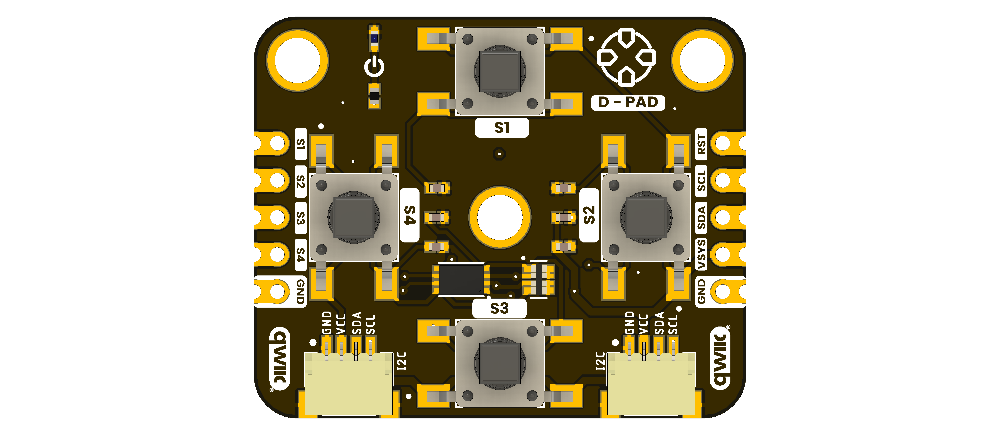

# DevLab I2C D-Pad Module

**MPN: UE0173**

The DevLab I2C D-Pad Module is an I2C directional input module in the UNIT Electronics DevLab family.

  
  
<em>DevLab I2C D-Pad Module</em>

### Quick Setup

## Overview

| Feature | Description |
|---|---|
| Product | DevLab I2C D-Pad Module |
| MPN | UE0173 |
| Interface | I2C |
| Available visuals | Product-specific top and bottom board views |
| Factory I2C Address | `0x27` (7-bit) |
| DDP Device ID | `0x0107` |
| Firmware Status | Stable |
| Firmware .bin Date | 2026-10-21 11:21 CST |

## Applications

- Directional input for menus and user interfaces.
- Four-button control in embedded prototypes.
- I2C input experiments with a host microcontroller.

## Resources

- [Hardware files and board views](hardware/README.md)
- [Product reference source](tools/product-reference/README.md)
- [Generic I2C scanner examples](software/README.md)
- [Controller firmware repository](https://github.com/UNIT-Electronics-Labs/unit_firmware_i2c_d_pad_module)
- [Arduino support library](https://github.com/UNIT-Electronics-MX/unit_devlab_dpad_library)

The supplied source package does not include a product-specific schematic. Check the product-specific pinout or schematic for wiring and electrical limits.

## 📝 License

All hardware and documentation in this project are licensed under the **MIT License**.
See the [repository license](LICENSE) for details.
