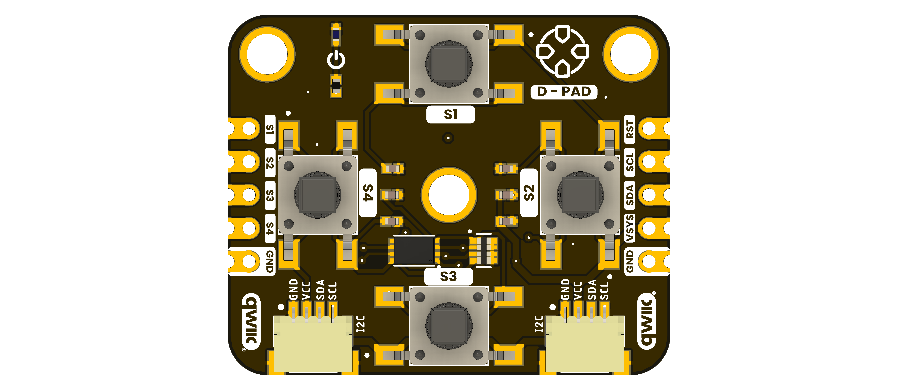
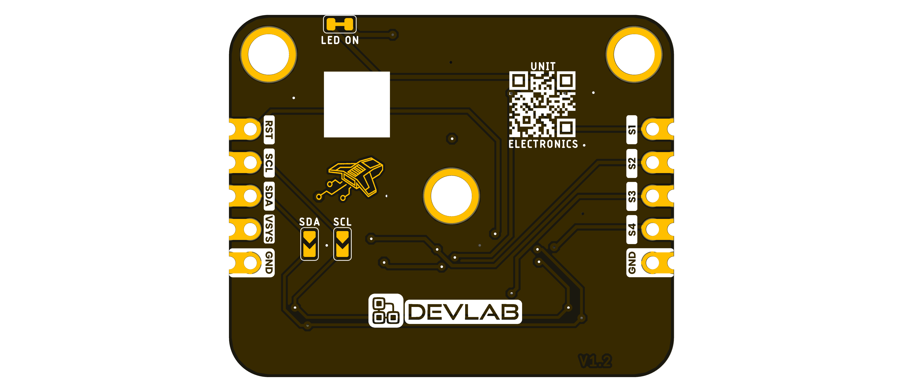
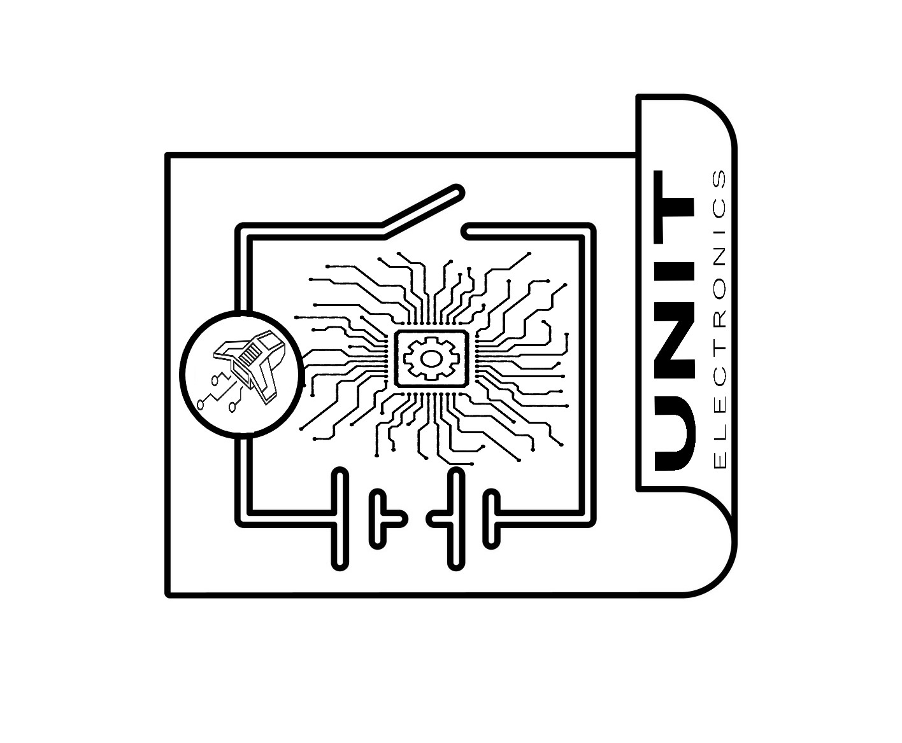

# DevLab I2C D-Pad Module Hardware

## Hardware Scope

This page records the available hardware files for **DevLab I2C D-Pad Module**. Values not supported by a product-specific drawing or schematic remain unspecified.

| Field | Value |
|---|---|
| MPN | UE0173 |

## Power Tree

A dedicated board-level power-tree drawing is not included in the available product-specific files.

## Block Diagram

A dedicated functional block diagram is not included in the available product-specific files.

## Naming Rules

- Product name: **DevLab I2C D-Pad Module**.
- Product family: **UNIT DevLab ecosystem**.
- Existing source filenames retain their published names and revisions.
- Generated Product Reference: `unit_product_reference_v_1_1_0_ue0173_devlab_i2c_d_pad_module.pdf`.

## Hardware

# Hardware

<a href="./unit_sch_v_1_0_0_ue0173_i2c_d-pad_module.pdf"> Schematic</a>

## Pinout

<a href="./unit_pinout_v_1_2_0_ue0173_i2c_d-pad_module_en.pdf">
 
Pinout
</a>

## Dimensions

<a href="./unit_dimensions_v_1_2_0_ue0173_i2c_d-pad_module.pdf">  Dimensions</a>

## Topology

<a href="./resources/unit_topology_v_1_2_0_ue0173_i2c_d-pad_module.png">  Topology</a>
 
 
 

## Pin & Connector Layout

A verified product-specific connector map is not included in the available source package. Do not infer electrical pin assignments from the board renders.

## Functional Description

The DevLab I2C D-Pad Module is an I2C directional input module in the UNIT Electronics DevLab family.

## Applications

- Directional input for menus and user interfaces.
- Four-button control in embedded prototypes.
- I2C input experiments with a host microcontroller.

## References

- [Product Reference](../docs/hardware/unit_product_reference_v_1_1_0_ue0173_devlab_i2c_d_pad_module.pdf)
- [Product Reference source](../tools/product-reference/README.md)
- [Electrical schematic](unit_sch_v_1_0_0_ue0173_i2c_d-pad_module.pdf)
