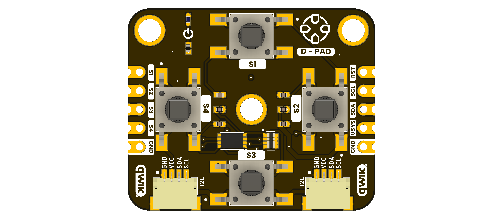
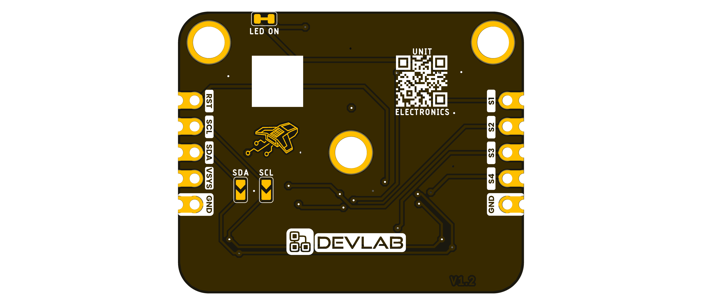

## **6 Mechanical Information**

The supplied board views identify the component and underside layouts of the UE0173 I2C D-Pad Module.
Use the labeled drawings for fit checks; do not infer dimensions by scaling a render.

### **6.1 Top View** {.section-page}

{width=5.4in}

### **6.2 Bottom View** {.section-page}

{width=5.4in}

### **6.3 Dimensional Data** {.section-page}

A controlled dimensioned drawing is not available in the selected source package.
Verify the board outline, mounting pattern, component heights, and connector
clearances before designing an enclosure or carrier.
